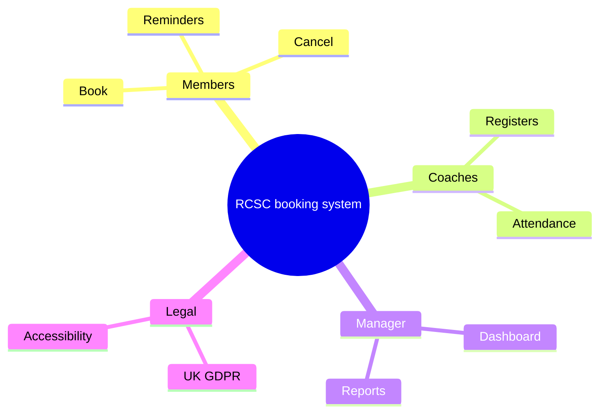
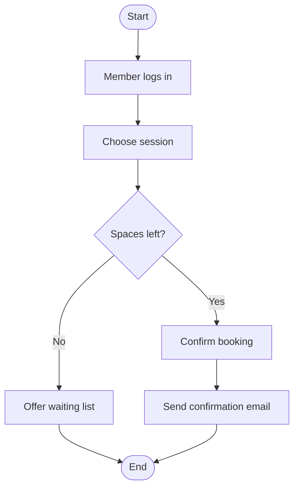
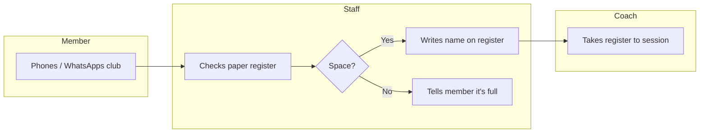
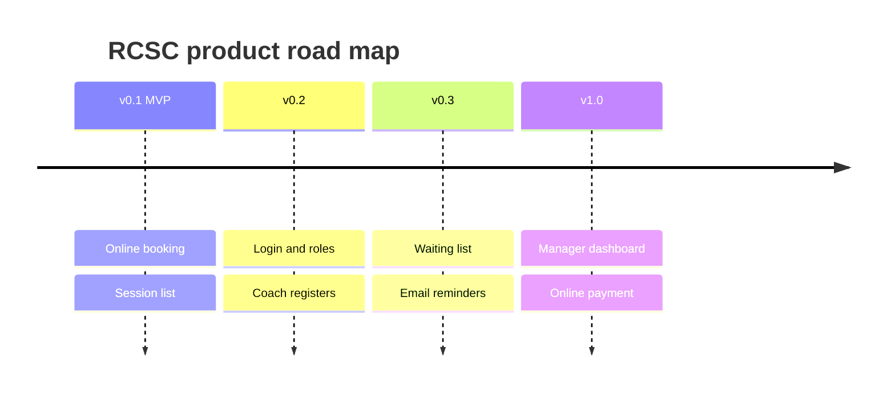
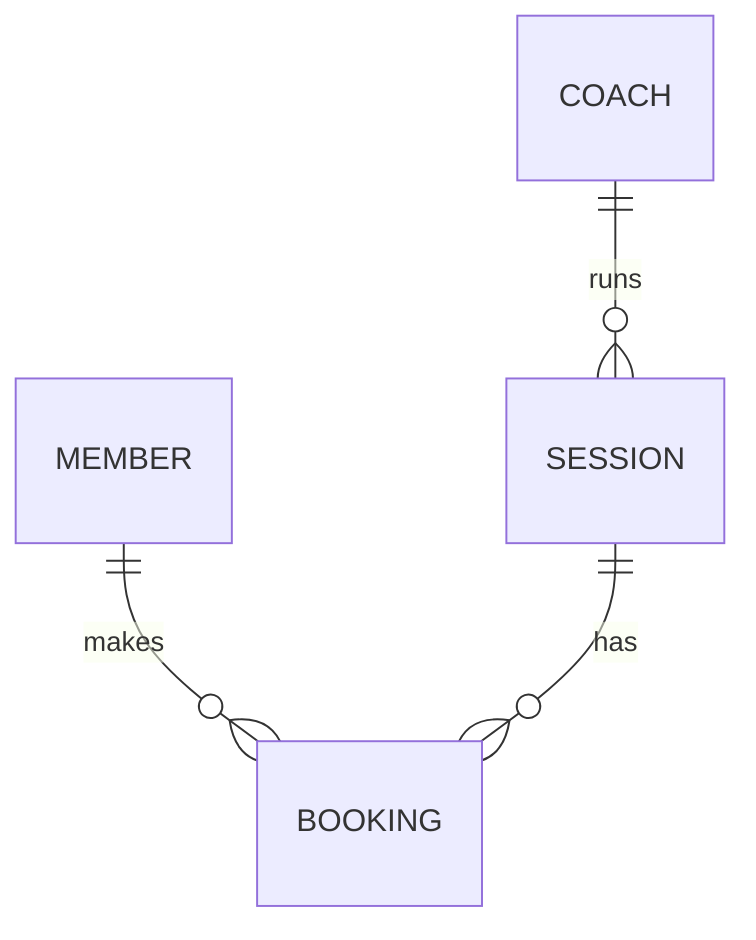

# Business Analysis Model Examples (Mermaid)

These render on GitHub and in most Markdown editors. Use them as starting points for the mock brief.

## Mind map

## Activity diagram: book a session

## Process diagram (swimlanes): current paper process

## Product road map

## ERD (analysis level)

