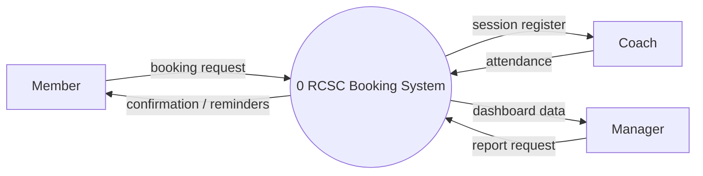
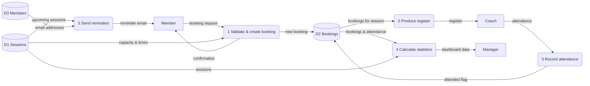

# Data Flow Diagram Example: RCSC booking system

DFD notation: **external entity** (rectangle), **process** (rounded box, numbered), **data store**
(open-ended box, D1...), **data flow** (labelled arrow). Every process must have at least one input
and one output.

## Level 0 (context diagram)

## Level 1

**Exercise:** add a level 1 process for the waiting list. What data stores does it read and write?
