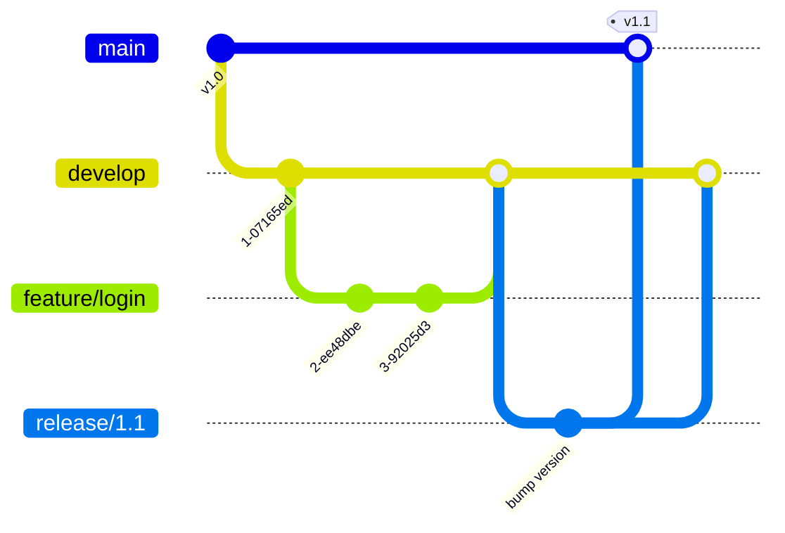

# Git Lab (lesson 04.06)

Work in pairs. One person creates the repo and the other is added as a collaborator.

## Part 1: basics
```bash
git init rcsc-lab && cd rcsc-lab
echo "# RCSC lab" > README.md
git add README.md
git commit -m "Add README"
git log --oneline
```

## Part 2: branch, commit, merge (GitHub Flow)
GitHub Flow: `main` is always deployable. Create a short-lived branch per feature, open a pull request,
get it reviewed, merge, deploy.
```bash
git switch -c feature/session-list
# ...edit files...
git add .
git commit -m "Add session list page"
git push -u origin feature/session-list
# Open a pull request on GitHub, ask your partner to review it with templates/collaboration/code-review-checklist.md, merge.
git switch main && git pull
```

## Part 3: cause and resolve a merge conflict
1. Both partners edit **the same line** of README.md on different branches.
2. Merge one branch, then try to merge the other.
3. Open the file, choose the correct content between `<<<<<<<`, `=======` and `>>>>>>>`, then:
```bash
git add README.md
git commit -m "Resolve README conflict"
```

## Part 4: GitFlow (compare)
GitFlow uses long-lived `main` and `develop` branches plus `feature/*`, `release/*` and `hotfix/*` branches.



| | GitHub Flow | GitFlow |
|---|---|---|
| Long-lived branches | `main` only | `main` + `develop` |
| Releases | Continuous | Scheduled release branches |
| Suits | Web apps with CI/CD, small teams | Versioned products, planned releases |

**Question:** Which suits a solo OSP project, and why? Which suits a 30-developer team shipping a mobile app every month?

## Good commit messages
- Imperative mood: "Add waiting list table", not "added stuff"
- One logical change per commit
- Reference the issue or user story: "Add cancel button (US04)"
