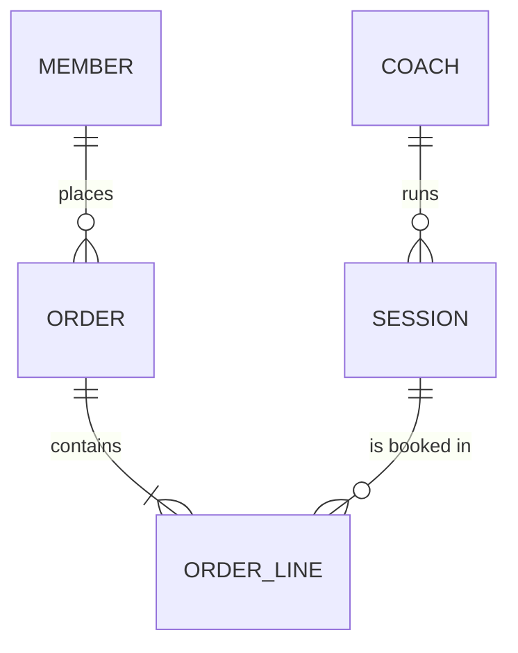

# Normalisation Worked Example: to 3NF

Start with [`unnormalised-orders.csv`](unnormalised-orders.csv), the club's old "orders" spreadsheet.

**Problems with it:**
- `items` and `coach_names` hold several values in one cell (repeating groups)
- member details are repeated on every order, so an update anomaly is waiting to happen
  (look at Mei Chen's email typo `exmaple.com`: fix it in one row and the others stay wrong)
- prices are stored inside text, so you can't calculate with them
- you can't record a coach without an order (insertion anomaly), and deleting order 1002 loses the
  fact that Cricket Nets costs £7 (deletion anomaly)

## UNF → 1NF: atomic values, no repeating groups, a primary key

One row per order line:

| order_no | line | order_date | member_no | member_name | member_email | session_name | qty | unit_price | coach_name |
|---|---|---|---|---|---|---|---|---|---|
| 1001 | 1 | 2027-03-02 | M01 | Aisha Khan | aisha.khan@... | Junior Football | 2 | 5.00 | Sam Okafor |
| 1001 | 2 | 2027-03-02 | M01 | Aisha Khan | aisha.khan@... | Fitness Circuit | 1 | 4.00 | Jordan Ellis |
| ... | | | | | | | | | |

PK = (order_no, line). `total_gbp` is removed because it is **derived** (it can be calculated).

## 1NF → 2NF: remove partial dependencies

Every non-key attribute must depend on the **whole** composite key.
- `order_date` and `member_no` depend on `order_no` alone, so they move to **ORDER**.
- `session_name`, `qty` and `unit_price` depend on the whole key, so they stay in **ORDER_LINE**.

| Table | Attributes |
|---|---|
| ORDER | **order_no**, order_date, member_no, member_name, member_email |
| ORDER_LINE | **order_no, line**, session_name, qty, unit_price, coach_name |

## 2NF → 3NF: remove transitive dependencies

No non-key attribute may depend on another non-key attribute.
- `member_name` and `member_email` depend on `member_no`, not on `order_no`, so they move to **MEMBER**.
- `unit_price` and `coach_name` depend on the session, not on the order line, so they move to **SESSION**.
  The coach then becomes its own table, **COACH**.

| Table | Attributes |
|---|---|
| MEMBER | **member_no**, member_name, member_email |
| COACH | **coach_id**, coach_name |
| SESSION | **session_id**, session_name, unit_price, *coach_id* |
| ORDER | **order_no**, order_date, *member_no* |
| ORDER_LINE | ***order_no*, line**, *session_id*, qty |

(**bold** = primary key, *italic* = foreign key)

> **Exam-style check:** "The key, the whole key, and nothing but the key."
> 1NF = the key; 2NF = the whole key; 3NF = nothing but the key.

**Exercise:** the club now wants sessions to have more than one coach. What happens to the design?
(Hint: an M:N relationship needs a link table, `SESSION_COACH`.)
