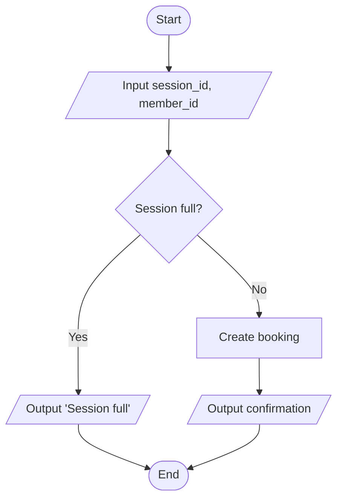

# Algorithm Design: [Key problem] (A#)

**Requirement(s):** · **Inputs:** · **Outputs:** · **Where it runs:** front end / back end / database

## Flowchart
_Standard BCS symbols: terminator, process, sub-process, decision, input/output, connector, flow line._
_Mermaid works well in Markdown:_



## Pseudocode
```
FUNCTION create_booking(member_id, session_id)
    IF NOT member_exists(member_id) THEN RETURN error("Unknown member")
    spaces <- capacity(session_id) - count_bookings(session_id)
    IF spaces <= 0 THEN RETURN error("Session full")
    insert_booking(member_id, session_id)
    RETURN success
END FUNCTION
```

## Data structures and validation used

## Why this approach (and alternatives rejected)
